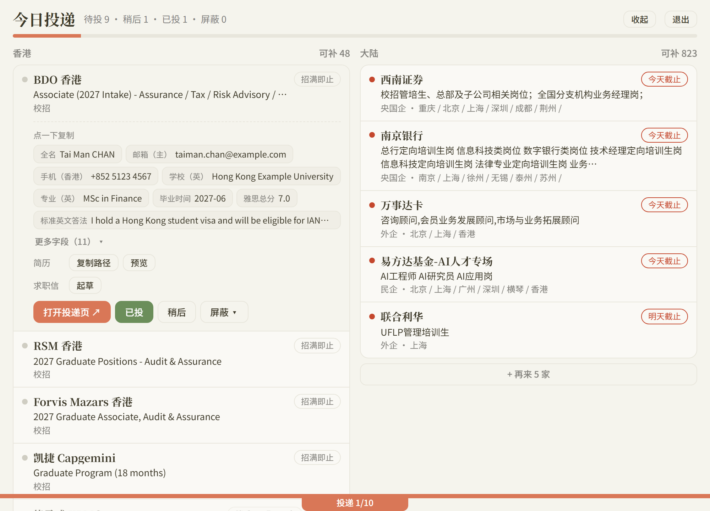

# 今日投递 · 小白教程

> 没写过代码也能装。两种方法任选：**① 交给 AI 装**（最省事，5 分钟）；**② 自己跟着做**（Windows，约 15 分钟）。

装好以后，每天会这样：

- **早上 10 点**：手机收到一条「今日投递简报」—— 香港、大陆各几家今天该投的岗位，按截止日排好，快截止的排最前
- **打开电脑**：屏幕顶边有个「投递」小把手，鼠标碰一下，面板滑下来 👇



点开一家：「打开投递页」直接跳到申请页面；填表时点一下灰色小方块就复制了姓名、邮箱、学校这些；投完点「已投」，明天不会再推。

---

## 方法 ①：交给 AI 装（推荐）

需要一个**能操作你电脑**的 AI 助手，比如 Claude Code、Codex、Cursor 这一类。
（网页版 ChatGPT / 豆包 / Kimi 只能聊天、碰不到你的电脑，用不了这个方法，请看方法 ②。）

把下面这一整段复制过去，它会一步步帮你装好，中间会问你几个问题：

```text
请帮我安装并配置开源项目「今日投递 job-digest」：https://github.com/cuizhuo2001/job-digest
它是给商科港硕用的每日投递助手：每天从岗位池里挑出今天该投的几家，推送到手机，电脑上还有一个投递面板。

请按顺序做，每做完一步用一两句话告诉我结果：

1. 检查电脑有没有 Python 3.9 或以上（python --version）。没有的话，教我去 python.org 下载安装，并提醒我勾选「Add python.exe to PATH」。
2. 把项目下载到一个好找的位置（Windows 建议 D:\job-digest），有 git 就 git clone，没有就下载 ZIP 解压。然后先读一遍 README.md 和 SKILL.md。
3. 复制 config.example.json 为 config.json，复制 profile.example.json 为 profile.json。
4. 问我这三个问题，再按我的回答改 config.json（改完检查是合法的 JSON）：
   - 想投哪些方向？把 presets/商科.json 里的 21 个方向列出来让我挑
   - 除了香港，还想在哪些城市工作？
   - 香港、大陆每天各推几家？（默认各 5 家）
5. 运行 python tools/push.py --dry 预览今天的简报（第一次会下载岗位数据，大约 1 分钟），把结果给我看。如果推荐的岗位明显不对口，帮我调整方向或排除词再试一次。
6. 问我想用飞书还是 Telegram 接收推送，一步步教我拿到机器人的 webhook / token，写进项目里的 secrets.json，再把 config.json 的 notify.channels 改成对应渠道。不要把密钥打印出来，也不要写进别的文件。然后运行 python tools/push.py 发一条真的，确认我收到了。
7. 如果我用的是 Windows、而且想要电脑面板：运行 pip install -r requirements.txt；问我中文简历和英文简历的 PDF 放在哪，填进 profile.json（路径里的反斜杠要写成 / ）；再照 templates/填表速查卡.example.md 的格式，问我要资料，帮我建一份自己的速查卡，在 profile.json 的 card_path 指过去。然后运行 pythonw tools/apply_popup.py，告诉我面板在屏幕顶边、怎么把它拉下来。
8. 问我同意后，运行 python tools/register_task.py，设置每天自动推送、开机自动启动面板。如果我用的是 Mac 或 Linux，改用 cron 每天定时运行 python tools/push.py。
9. 最后用几句话告诉我：每天怎么用、投完怎么标记、看到新岗位怎么用 tools/add_job.py 补录。

注意：这个工具只负责告诉我投什么，不要替我在任何招聘网站上提交申请；我的个人资料只保存在本机这几个文件里。
```

---

## 方法 ②：自己跟着做（Windows）

### 第 1 步：装 Python

1. 打开 <https://www.python.org/downloads/>，点黄色的 **Download Python 3.x** 按钮
2. 运行下载的安装包，**第一个界面最下面勾上「Add python.exe to PATH」**（最容易漏的一步），再点 Install Now
3. 检查是否装好：按 `Win + R`，输入 `cmd` 回车，在黑色窗口里输入下面这行，回车：

```bash
python --version
```

出现 `Python 3.12.x` 这样的版本号就对了。如果提示「不是内部或外部命令」，或者弹出了微软应用商店，说明第 2 步没勾上，重新运行安装包，选 Modify 把它勾上。

### 第 2 步：下载项目

1. 打开 <https://github.com/cuizhuo2001/job-digest>
2. 点绿色的 **Code** 按钮 → **Download ZIP**
3. 解压到一个好找的地方，比如 `D:\job-digest`

> 解压后如果多了一层 `job-digest-main` 文件夹，没关系，以后说的「项目文件夹」都是指**能看到 README.md 的那一层**。

### 第 3 步：打开命令行

在资源管理器里打开项目文件夹，**点一下顶部的地址栏，输入 `cmd`，回车**。会弹出一个黑色窗口，它已经在项目文件夹里了。后面所有命令都在这个窗口里输入。

### 第 4 步：第一次预览

依次输入这三行（每行输完回车）：

```bash
copy config.example.json config.json
copy profile.example.json profile.json
python tools\push.py --dry
```

第一次会下载岗位数据，等 1 分钟左右，然后会打印出今天的简报：香港几家、大陆几家，每家写着截止日。看到这个就说明装好了 🎉

### 第 5 步：改成你想投的方向和城市

右键 `config.json` → **打开方式** → **记事本**，找到这两行：

```json
"directions": ["管培", "风控合规", "审计税务", "财务会计", "咨询", "数据分析", "银行业务", "研究", "市场品牌"],
"allowed_cities": ["香港", "深圳", "广州", "上海"],
```

- `directions` 改成你想投的方向，可选：管培、投行、销售交易、研究、资管财富、风控合规、银行业务、保险精算、金融科技、审计税务、财务会计、咨询、战略投资、市场品牌、销售商务、运营、产品、数据分析、人力资源、供应链、行政综合
- `allowed_cities` 改成你想去的城市（只影响大陆岗位，香港岗位总是保留）

⚠️ 改的时候注意：**引号和逗号都用英文的**，最后一项后面不加逗号。保存后再跑一次 `python tools\push.py --dry` 看看效果。如果报错里有 `Expecting`，多半是逗号或引号写错了。

### 第 6 步：让简报推到手机

两种都可以，选一种：

**飞书（内地、香港都能用）**

1. 在飞书里建一个群（只放你自己也行，或者拉个朋友进来）
2. 群设置 → **群机器人** → 添加机器人 → **自定义机器人** → 起个名字
3. 复制它给你的 **webhook 地址**；「安全设置」勾选 **签名校验**，复制那串密钥
4. 在项目文件夹里新建一个文本文件，改名为 `secrets.json`（注意把 `.txt` 后缀去掉），用记事本写入：

```json
{
 "feishu_webhook": "这里粘贴 webhook 地址",
 "feishu_secret": "这里粘贴签名密钥"
}
```

5. 打开 `config.json`，把 `"notify": {"channels": ["console"]}` 改成 `"notify": {"channels": ["feishu"]}`

**Telegram（香港能直接用，内地要挂代理）**

1. 在 Telegram 里找 **@BotFather**，发 `/newbot`，按提示起名，会得到一串 token（像 `123456:ABC-xxx`）
2. 给你刚建的机器人随便发一条消息
3. 浏览器打开 `https://api.telegram.org/bot你的token/getUpdates`，在结果里找 `"chat":{"id":` 后面那串数字，就是你的 chat id
4. 新建 `secrets.json`，写入：

```json
{
 "telegram_token": "你的 token",
 "telegram_chat": "你的 chat id"
}
```

   在内地的话，再加一行 `"telegram_proxy": "http://127.0.0.1:7890"`（换成你代理软件的端口），记得在上一行末尾补个英文逗号。

5. `config.json` 里改成 `"notify": {"channels": ["telegram"]}`

**测试**：命令行里输入下面这行（不带 `--dry` 就是真发），手机收到就成功了：

```bash
python tools\push.py
```

### 第 7 步：电脑面板（可选）

1. 装面板需要的组件：

```bash
pip install -r requirements.txt
```

2. 用记事本打开 `profile.json`，填上你的名字、邮箱、电话，以及简历 PDF 的位置。⚠️ **路径里的 `\` 要写成 `/`**，比如 `"hk": "D:/简历/Resume_EN.pdf"`
3. 填表速查卡：把 `templates\填表速查卡.example.md` 复制一份，比如叫 `我的速查卡.md`，用记事本把里面的示例资料换成你的；然后在 `profile.json` 里把 `card_path` 改成 `"我的速查卡.md"`。面板上那些「点一下复制」的小方块就是从这里来的
4. 启动面板：

```bash
pythonw tools\apply_popup.py
```

面板会贴在**屏幕顶边中间**，平时只露出一条细边和一个「投递」小把手。鼠标移上去停一下，它就滑下来；移开就缩回去。把它拖离顶边，就变成普通窗口。屏幕右下角托盘里有它的图标，右键可以退出。

### 第 8 步：设成每天自动

```bash
python tools\register_task.py
```

设好以后：每天 10:00 自动推送简报；开机登录 30 秒后面板自动出现；10:40 和 16:00 面板会自己滑下来提醒你。
想改时间，在 `config.json` 的 `schedule` 里改，然后再运行一次这行命令。

---

## 每天怎么用

1. **早上看手机**：今天推了哪几家、有没有快截止的、关注的公司有没有新挂岗位（🆕 那一段）
2. **打开面板一家家投**：点开一家 →「打开投递页」→ 填表时点小方块复制资料 →「简历 · 复制路径」后在上传框里 `Ctrl+V` → 投完点 **已投**
3. **今天不想投**：点 **稍后**，明天它会排在最前面
4. **不想要这家**：点 **屏蔽**，选个原因（链接失效 / 不想投这家公司 / 条件不符……），面板当场补一家新的
5. **看到池子里没有的岗位**（官网、群里、学校就业网）：

```bash
python tools\add_job.py
```

   它会一项项问你公司、岗位、链接、截止日，填完就加进去了。

6. **想多关注一家香港公司**：看 README 里「岗位数据从哪来」那一节，照格式往 `watchlist_hk.json` 加一行

---

## 常见问题

**推荐的岗位不太对口？**
大陆岗位很多是「一家公司的整份校招公告」，标题里一长串类别，只要提到你选的方向就会被推。可以在 `config.json` 的 `exclude_title` 里加你不想要的词（比如 `"销售"`、`"客户经理"`），或者少选几个方向。

**没收到推送？**
打开项目文件夹里的 `push.log`，看最后几行写了什么。最常见的是：`secrets.json` 没写对，或者 Telegram 在内地没挂代理。

**面板没出现？**
看屏幕右下角托盘有没有它的图标，可能已经在运行了，只是缩在顶边。同一时间只能开一个面板。

**数据多久更新一次？**
每次推送前自动检查，超过 20 小时就重新下载。简报底部会写「池子快照 X 月 X 日」，太久没更新会提醒你。大陆岗位库的更新取决于上游项目，不是每天都有新数据。

**我用 Mac / Linux？**
每日简报能用：照第 1–6 步做（命令里的 `\` 换成 `/`，`copy` 换成 `cp`），然后用 cron 每天定时运行 `python3 tools/push.py`。电脑面板和第 8 步目前只支持 Windows。

**它会替我投简历吗？**
不会。它只告诉你今天投什么、把材料准备好，申请表还是你自己点提交。你的资料只存在你电脑上的 `profile.json`、速查卡和 `secrets.json` 里，不会上传到任何地方。
